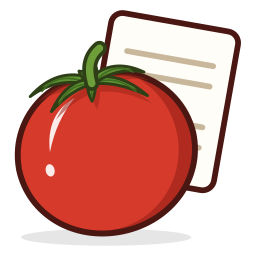
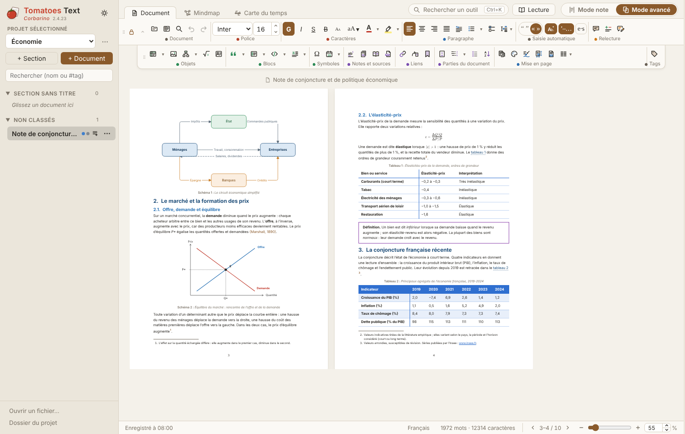
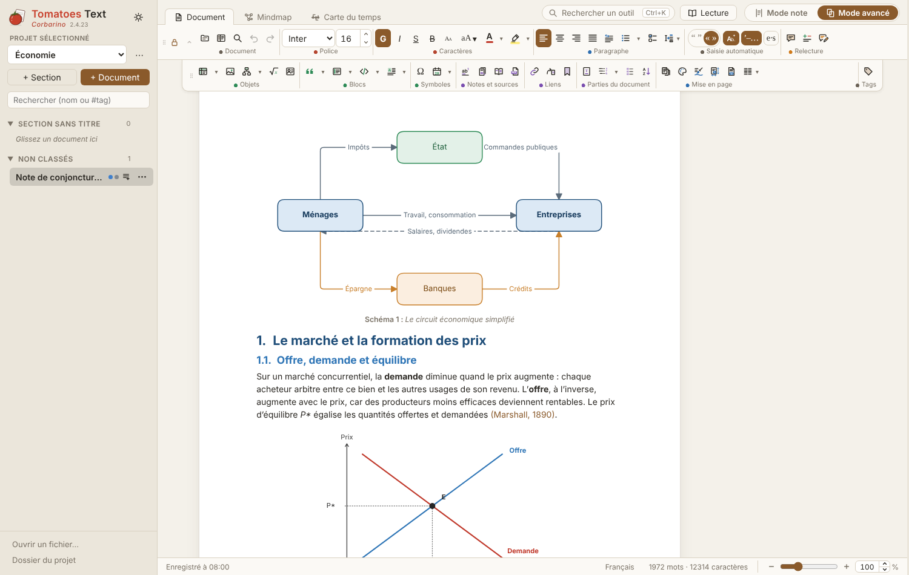
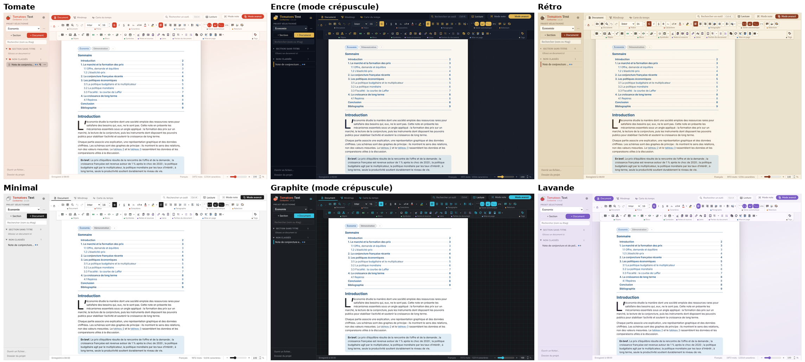

<p align="center">
  
</p>

<h1 align="center">Tomatoes Text</h1>

<p align="center">
  Logiciel de rédaction de notes et de documents pour Windows, hors ligne, en français.<br>
  <a href="https://github.com/Fissqui/Tomatoes-Text/releases/latest"><strong>Télécharger la dernière version</strong></a>
  · <a href="CHANGELOG.md">Historique des versions</a>
</p>



Tomatoes Text réunit la prise de notes et la rédaction de documents longs dans un même outil. Les notes sont
classées en projets et reliées entre elles ; le même texte peut ensuite être mis en page, paginé et exporté
en Word, PDF, livre ou EPUB. Toutes les données restent sur l'ordinateur : aucune inscription, aucun service en
ligne nécessaire.

## Fonctionnalités

**Écriture et mise en forme**
- Mise en forme complète : polices (17 polices libres intégrées), tailles, couleurs, surlignage, petites
  capitales, lettrine, alignements, colonnes.
- Titres, listes, encadrés, citations, tableaux, images, formules mathématiques, schémas, graphiques, code
  avec coloration syntaxique.
- Typographie française automatique : majuscule en début de phrase, guillemets, ordinaux (19ᵉ, 1ᵉʳ), espaces
  insécables, point médian.
- Mini-barre de mise en forme sur la sélection, palette de commandes (Ctrl+K), raccourcis personnalisables.



**Organisation**
- Projets et sections dans le panneau latéral, tags, recherche.
- Liens entre documents (`((Nom du document))`) et vers des sites web.
- Mindmap des documents liés et carte du temps construite à partir des dates du texte.
- Historique des versions de chaque document, suivi des modifications, commentaires, signets.

**Mise en page**
- Mode note (texte continu) et mode avancé (pages réelles, en-têtes, pieds de page, numérotation, pages en
  paysage).
- Notes de bas de page, notes de fin, renvois, table des matières, index, bibliographie et citations
  (styles APA, Chicago, ISO 690…).
- Pages de titre, modèles de documents, thèmes du document et styles par type d'élément.
- Documents de plusieurs centaines de pages.

**Relecture et aide à la rédaction**
- Orthographe (Hunspell) en français, anglais, allemand, espagnol, italien et portugais ; plusieurs langues
  dans un même document.
- Grammaire avec LanguageTool, exécuté localement.
- Synonymes, doublons, lisibilité, vérification de la cohérence (noms, dates).
- Aide au texte (AAT) : reformulation, résumé et propositions par un modèle de langage local
  (Mistral, via llama.cpp), sans connexion à un service externe.

**Import et export**
- Import de documents Word (.docx).
- Export Word (.docx), PDF, livre imprimable (marges de reliure, fonds perdus) et EPUB.

**Apparence**
- Modes jour, crépuscule et nuit ; seize thèmes du logiciel et de nombreux réglages d'aspect.
- Mode lecture, double page, mode concentration, zoom de 25 à 300 %.



## Installation

1. Téléchargez `Tomatoes-Text-Installation-<version>.exe` depuis la
   [page des versions](https://github.com/Fissqui/Tomatoes-Text/releases/latest).
2. Lancez le fichier. L'installation se fait pour l'utilisateur courant, sans droits d'administrateur, et crée
   les raccourcis du Bureau et du menu Démarrer.

Le programme d'installation n'est pas signé numériquement. Au premier lancement, Windows peut afficher
« Windows a protégé votre ordinateur » : choisissez **Informations complémentaires**, puis
**Exécuter quand même**.

Configuration requise : Windows 10 ou 11 (64 bits). L'aide au texte par modèle de langage nécessite plusieurs
gigaoctets d'espace disque pour le modèle, téléchargé à la demande depuis le logiciel.

**Mises à jour.** Le menu **Aide > Rechercher une mise à jour…** vérifie la dernière version publiée et
l'installe. Une recherche est également faite au démarrage ; une notification apparaît dans la barre d'état
lorsqu'une nouvelle version est disponible.

**Désinstallation.** Paramètres Windows > Applications > Tomatoes Text. Les documents et les réglages sont
conservés.

## Documents

Les documents sont enregistrés automatiquement dans `Documents\Tomatoes Text`, au format `.tmtx` : un fichier
JSON lisible contenant le texte (HTML), les réglages de page et les métadonnées du document.

```json
{
  "format": "frame-text",
  "version": 1,
  "id": "identifiant unique",
  "title": "Titre",
  "created": "2026-01-01T09:00:00.000Z",
  "modified": "2026-01-01T09:30:00.000Z",
  "settings": { "mode": "note", "pages": { "size": "A4", "orient": "portrait" } },
  "content": { "html": "<p>Texte mis en forme</p>" },
  "links": [],
  "meta": {}
}
```

L'identifiant `id` ne change pas lorsque le document est renommé ; les liens entre documents s'appuient sur lui.

## Développement

Prérequis : [Node.js](https://nodejs.org) 22 ou supérieur.

```sh
npm install
npm start              # lance le logiciel
npm run build:win      # fabrique le programme d'installation Windows (nécessite makensis, paquet nsis)
```

Organisation du dépôt :

| Dossier | Contenu |
| --- | --- |
| `src/main.js`, `src/*.js` | Processus principal Electron : fenêtre, menus, fichiers, mise à jour, correcteurs, modèle local |
| `src/preload.js` | Pont entre l'interface et le processus principal |
| `src/renderer/` | Interface (HTML, CSS, JavaScript) |
| `src/renderer/moteur/` | Moteur d'édition, fondé sur ProseMirror : schéma, pagination, objets |
| `src/vendor/`, `src/renderer/vendor/` | Composants tiers (dictionnaires, thésaurus, ProseMirror, pdf.js, MathLive, docx) |
| `src/presentation/` | Documents de présentation ouverts au premier lancement |
| `scripts/banc-essai/` | Tests de bout en bout (Playwright) : `node scripts/banc-essai/run.js scripts/banc-essai/essai-complet.js` |
| `scripts/build-windows.js`, `installer/` | Fabrication du programme d'installation (NSIS) |
| `build/` | Icônes du logiciel et des fichiers `.tmtx` |

### Publication d'une version

Le numéro de version figure dans `package.json` et `src/version.json`, qui doivent rester identiques.
Lorsqu'un nouveau numéro arrive sur la branche `main`, le workflow
[`publication.yml`](.github/workflows/publication.yml) fabrique le programme d'installation et publie la
version sur GitHub Releases avec deux fichiers :

- `Tomatoes-Text-Installation-<version>.exe` : programme d'installation complet ;
- `Tomatoes-Text-<version>-fichiers.tar.gz` : fichiers du logiciel, utilisés par la mise à jour intégrée
  lorsque ni Electron ni les composants natifs ne changent.

Les notes de la version reprennent les messages des commits publiés depuis la version précédente.

## Composants tiers

Tomatoes Text s'appuie notamment sur [Electron](https://www.electronjs.org) (MIT),
[ProseMirror](https://prosemirror.net) (MIT), [pdf.js](https://mozilla.github.io/pdf.js/) (Apache 2.0),
[MathLive](https://cortexjs.io/mathlive/) (MIT), [docx](https://docx.js.org) (MIT),
[node-llama-cpp](https://node-llama-cpp.withcat.ai) (MIT), [Hunspell](https://hunspell.github.io)
(LGPL/GPL/MPL) et ses dictionnaires, les thésaurus de LibreOffice (LGPL/GPL),
[LanguageTool](https://languagetool.org) (LGPL 2.1) avec Java [Eclipse Temurin](https://adoptium.net)
(GPL 2.0 avec exception « Classpath »), livrés avec le programme d'installation, et des polices sous
licence SIL Open Font License. Les modèles Mistral (Apache 2.0) de l'Aide au Texte sont téléchargés à la
demande. Les portraits des repères biographiques, tirés de Wikimedia Commons, sont dans le domaine public.

La liste complète des composants, de leurs licences et de leurs auteurs est dans
[`src/licences/MENTIONS.txt`](src/licences/MENTIONS.txt), avec les textes des licences ; elle est aussi
accessible dans le logiciel par Aide > Mentions et licences.

## Licence

© 2026 Fissqui. Tous droits réservés. Le code source est publié pour consultation ; les composants tiers
restent soumis à leurs licences respectives.
